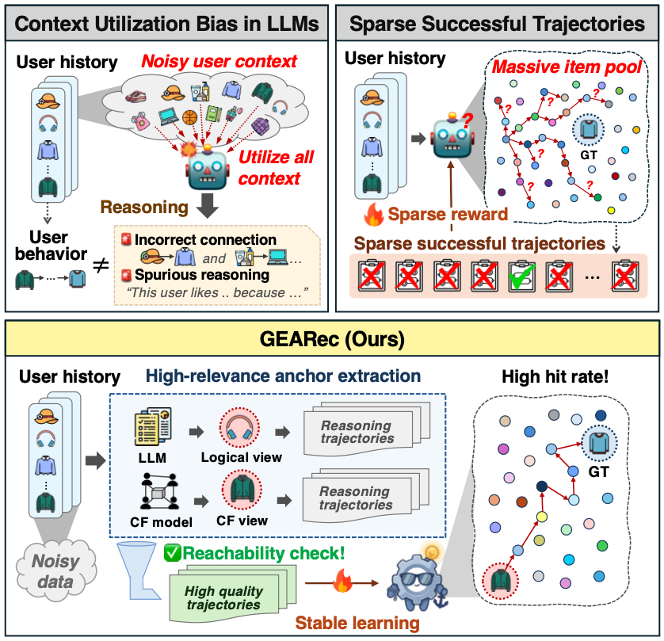
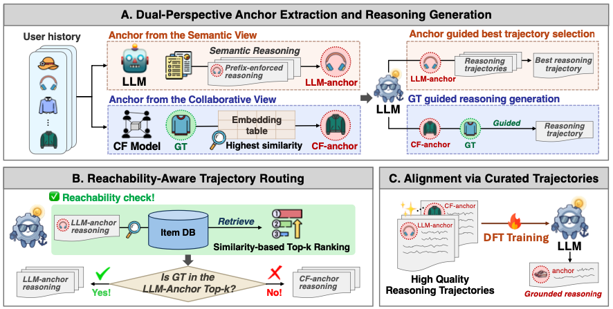

# GEARec: Grounded Extraction for Anchor-based Recommendation

Official implementation of **GEARec**, a grounded data-curation and alignment framework for **LLM-based sequential recommendation**.

GEARec is designed for practical recommendation settings where a user's interaction history is long, noisy, and only partially connected to the final target item. Instead of asking an LLM to explain the entire history at once, GEARec first identifies a **high-relevance anchor item** from the history and then constructs **grounded reasoning trajectories** around that anchor. This yields more focused supervision and better alignment between generated reasoning and actual retrieval outcomes.

---

## Abstract

Large Language Models (LLMs) in sequential recommendation often struggle to use long interaction histories effectively. They tend to overuse noisy context when constructing explanations and retrieval trajectories, which leads to diffuse reasoning and makes autonomous exploration methods such as reinforcement learning or rejection sampling less effective in massive item pools.

GEARec addresses this issue through **Dual-Perspective Anchor Extraction** and **Hybrid Reasoning Generation**. By combining the semantic strengths of LLMs with collaborative filtering (CF) signals, GEARec identifies a high-relevance anchor item from the user's history and uses it to build more focused reasoning trajectories. It then applies **Reachability-Aware Trajectory Routing** to retain only trajectories that are actually useful for retrieval, and uses these curated trajectories for downstream alignment.

At inference time, GEARec operates in a **single pass**: the model reads the user history, autonomously identifies the anchor item, generates a grounded reasoning trajectory, and retrieves items efficiently via dense embedding search.

---

## Overview

### Why existing methods fail

Existing LLM-based recommendation pipelines often suffer from **context-utilization bias**. The model tends to forcefully connect too many past interactions, including weakly relevant or noisy ones, which leads to spurious reasoning and sparse successful trajectories.



### What GEARec does differently

GEARec identifies a **single high-relevance anchor item**, constructs reasoning trajectories from both the **semantic view** and the **collaborative view**, and then routes only **reachable** trajectories into the final training set.



---

## Method

GEARec consists of three phases:

1. **Dual-Perspective Anchor Extraction and Reasoning Generation**
2. **Reachability-Aware Trajectory Routing**
3. **Alignment via Curated Trajectories**

### 1. Dual-Perspective Anchor Extraction and Reasoning Generation

To reduce context overuse, GEARec extracts a single **high-relevance anchor item** from the user history and builds reasoning around it. The framework uses two complementary perspectives:

#### 1.1 LLM Reasoning (without GT)

The LLM first identifies a semantic anchor from the user history without access to the target item.

To do this, GEARec uses a **prefix-enforcement strategy**: each history item is treated as an anchor candidate, and the LLM is forced to begin its response from that candidate item. This produces multiple candidate reasoning trajectories, each grounded on a different historical item.

Among these candidates, the one whose generated trajectory achieves the best retrieval rank for the hidden target item is selected as the **LLM anchor**. Then, a **Best-of-N** sampling procedure is applied to generate multiple diverse reasoning trajectories conditioned on that anchor, and the best one is retained as the final **LLM reasoning trajectory**.

#### 1.2 CF Reasoning (with GT guidance)

Because semantic reasoning alone may fail to capture non-intuitive global consumption patterns, GEARec also introduces a **collaborative filtering (CF) anchor**.

Using pre-trained CF item embeddings, the framework selects the history item that is most similar to the target item in the collaborative latent space. The LLM is then prompted with both the **CF anchor** and the **target item** to verbalize their relationship and generate a **CF-guided reasoning trajectory**.

This step translates collaborative knowledge into natural-language supervision.

---

### 2. Reachability-Aware Trajectory Routing

Not every generated trajectory is useful for retrieval. Some trajectories may sound plausible but still fail to retrieve the target item from a large candidate pool.

To address this, GEARec evaluates each generated trajectory using a frozen dense text encoder and a retrieval backend:

- If the **LLM reasoning trajectory** successfully retrieves the target item within a predefined **Top-K** threshold, it is selected.
- Otherwise, the framework checks whether the **CF anchor** itself has sufficient collaborative relevance to the target item under a stricter **Top-M** criterion.
- If so, the **CF reasoning trajectory** is used instead.
- If neither condition is satisfied, the instance is discarded.

This routing process ensures that the final training data contains only **grounded and reachable reasoning trajectories**.

---

### 3. Alignment via Curated Trajectories

The curated dataset is then used for alignment in two steps:

#### 3.1 Dynamic Fine-Tuning (DFT)

Rather than relying only on standard teacher-forcing SFT, GEARec adopts **Dynamic Fine-Tuning (DFT)** to stabilize optimization and improve generalization. DFT reweights token-level updates based on inverse policy probability, allowing the LLM to adapt more smoothly to the recommendation domain.

#### 3.2 Semantic-to-Collaborative Alignment

The generated reasoning trajectory is encoded with a frozen dense text encoder and projected into the collaborative retrieval space. Item representations are projected into the same latent space, and the model is optimized using a contrastive objective so that the reasoning-derived user query embedding aligns with the target item embedding.

This step ensures that the generated text is not only coherent, but also directly useful for large-scale retrieval.

---

## Inference

During inference, GEARec operates as a **single-pass retrieval pipeline**:

1. The fine-tuned LLM receives the user history.
2. It autonomously identifies the anchor item and generates a grounded reasoning trajectory.
3. The generated text is encoded by a frozen text encoder.
4. A learned projection layer maps the encoded trajectory into the collaborative latent space.
5. Retrieval is performed by similarity search against projected item embeddings.

This enables recommendation without external anchor search or multi-stage online generation.


GEARec consists of three stages.

### 1. Key Item Extraction

Given a user history, the LLM is prompted to:

- Identify the **single key item** from the history that most strongly motivates the next purchase.
- Generate a detailed, paragraph-length **intent query** (3–5 sentences) explaining why that item influenced the user, what attributes they value, and how this leads to the next purchase.

The output follows a structured tag format:

```
<key_item>[Key Item Name]</key_item>
<query>[A detailed paragraph describing the user's preferences and future intent]</query>
```

To find the best anchor, GEARec runs key item extraction in **item-prefix mode**: for each user, it generates one prompt per history item (appending that item as the forced anchor) and collects N candidate trajectories. This corresponds to `--item_prefix` in `src/generate_key_selection.py`.

---

### 2. Reachability Evaluation

Not every generated query is useful for retrieval. GEARec evaluates each trajectory by:

- Encoding `key_item title + query text` with a dense text encoder (e.g., `mixedbread-ai/mxbai-embed-large-v1`).
- Computing the **retrieval rank** of the ground-truth target item against the full item pool.
- Saving the rank score per trajectory in a ranked CSV.

This step is handled by `src/eval_key_selection.py`.

---

### 3. Best-of-N Sampling and SFT

Using the ranked CSV:

1. **Best-of-N generation** (`src/generate_key_selection.py --ranked_csv`): For each user, the history item with the lowest (best) rank is selected as the anchor. The LLM then generates N samples (e.g., N=8) with temperature > 0 to produce diverse trajectories.
2. **Reachability re-evaluation** (`src/eval_key_selection.py`): The best-of-N samples are ranked again to identify which trajectories can retrieve the target.
3. **SFT on reachable trajectories** (`src/train_sft.py`): Only samples whose rank is within `--max_rank_threshold` (e.g., top-100) are retained for supervised fine-tuning using TRL's `SFTTrainer`.

---

## Running the Pipeline

The pipeline follows four main stages. All scripts are in `runs/`.

### Stage 1 — Key Item Extraction

**1a. Basic (test split, no forced anchor)**

```bash
bash runs/1_key_selection_basic.sh
```

Runs `src/generate_key_selection.py` over the test split for all four datasets.  
Outputs: `data_processed/{dataset}_gemma-3-1b-it_test_key_selection.csv`

**1b. Item-prefix mode (train/valid splits)**

```bash
bash runs/2_key_selection_prefix_titles.sh
```

For each user, generates one prompt per history item (N-item history → N prompts).  
Uses `--item_prefix` flag. Outputs: `data_processed/{dataset}_gemma-3-1b-it_{split}_key_selection_prefix.csv`

**1c. Preselected anchor (test split)**

```bash
bash runs/3_key_selection_preselected.sh
```

Reads an externally provided anchor CSV and injects it via `--preselected_csv`.

---

### Stage 2 — Reachability Evaluation

```bash
bash runs/4_eval_key_selection_all.sh
```

Encodes each `(key_item, query)` pair with `mixedbread-ai/mxbai-embed-large-v1`, computes retrieval rank against the full item pool, and saves the rank column.  
Outputs: `data_processed/{dataset}_gemma-3-1b-it_{split}_key_selection_prefix_ranked.csv`

Key settings:
- `--emb_type item_preference_1024_gemma-3-4b-it`
- `--emb_model_name mixedbread-ai/mxbai-embed-large-v1`

---

### Stage 3 — Best-of-N Sampling and Re-evaluation

**3a. Best-of-N generation**

```bash
bash runs/5_best_postfix_sample8.sh
```

Selects the best anchor per user from the ranked CSV and samples N=8 trajectories at temperature=1.0.  
Outputs: `data_processed/{dataset}_gemma-3-1b-it_{split}_key_selection_best_from_*_ranked.csv`

**3b. Re-evaluate best-of-N**

```bash
bash runs/6_eval_postfix_all.sh
```

Evaluates the best-of-N outputs and assigns retrieval ranks.  
Outputs: `data_processed/{dataset}_..._ranked_ranked.csv`

---

### Stage 4 — SFT Training

```bash
bash runs/7_sft_key_selection.sh
```

Fine-tunes `google/gemma-3-1b-it` using TRL `SFTTrainer` on selected samples.

---

## Output Format

The LLM is trained to produce structured output in the following format:

```
<key_item>Wireless Earbuds</key_item>
<query>
The user has consistently gravitated toward portable audio accessories, ...
This suggests a strong intent to explore complementary wireless audio products ...
</query>
```

---

## Key Design Choices

- **Anchor before reasoning**: prevents the LLM from over-explaining the full user history.
- **Item-prefix forcing**: systematically tests every history item as a potential anchor to find the most retrievable one.
- **Reachability filtering**: keeps only reasoning that leads to actual retrieval success (rank ≤ threshold).
- **Best-of-N at high temperature**: explores diverse phrasings anchored to the best item before SFT filtering.
- **Single-pass inference**: at test time, only one forward pass through the LLM is needed.

---

## Expected Outcome

GEARec is intended for researchers who want to study how LLM reasoning can be made more grounded, retrieval-aware, and practically useful in recommendation systems. The main hypothesis is that recommendation quality improves when supervision is built from **reachable anchor-grounded reasoning trajectories** rather than unconstrained free-form explanations.

